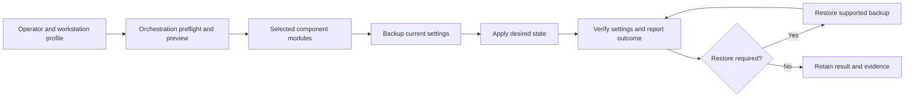
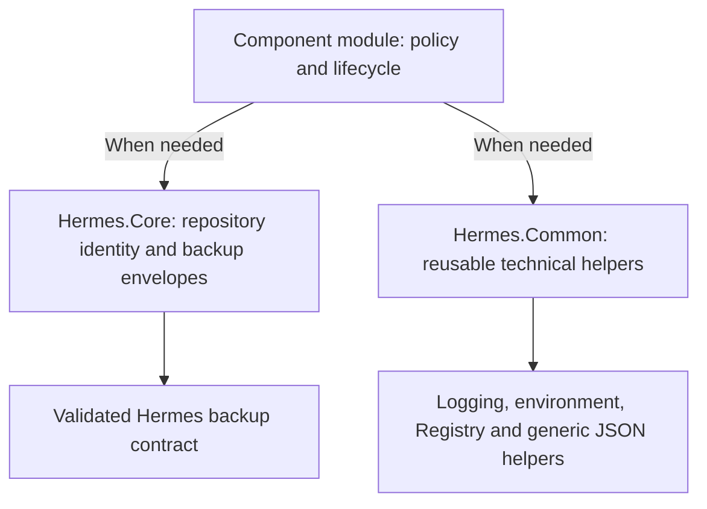

# Hermes system architecture

This view summarizes the documented workstation lifecycle and accepted shared-module boundary. It describes source responsibilities, not the current compliance of a particular workstation. Module support varies; preview, backup and restore apply where the selected component implements those contracts.

## Workstation lifecycle

Use preflight and supported WhatIf/confirmation behavior before applying changes. A restore is a deliberate recovery path, not a step that follows every successful apply. Reports distinguish completed, skipped, drifted and failed work.

## Dependency direction

Core and Common are peers. There is intentionally no dependency edge between them. Components import either or both only when required; Core owns the Hermes backup envelope while Common owns generic helpers. Component policy and desired state remain outside the shared modules.

## Source records and limits

- [Workstation lifecycle and current release](../../README.md)
- [Accepted shared-module architecture](shared-module-architecture.md)

These diagrams add documentation only. They do not change imports, backup semantics, supported operating systems or release acceptance. They contain no machine-specific paths or credentials.
